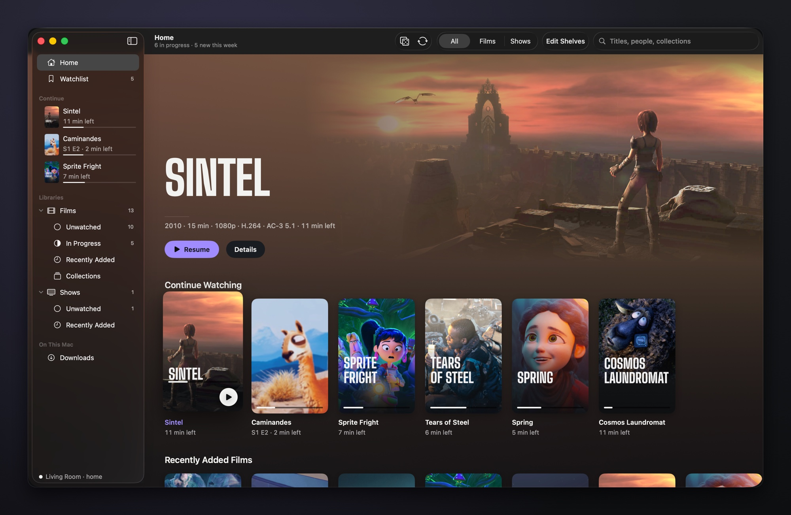
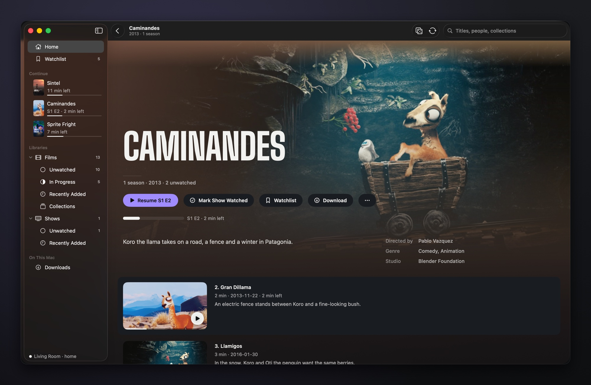
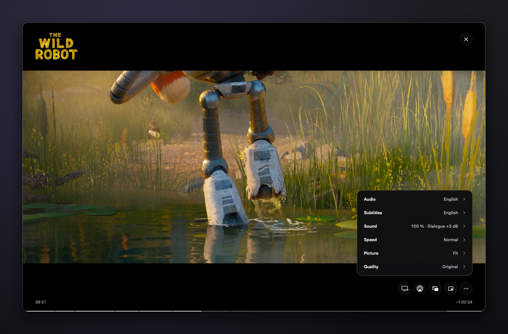
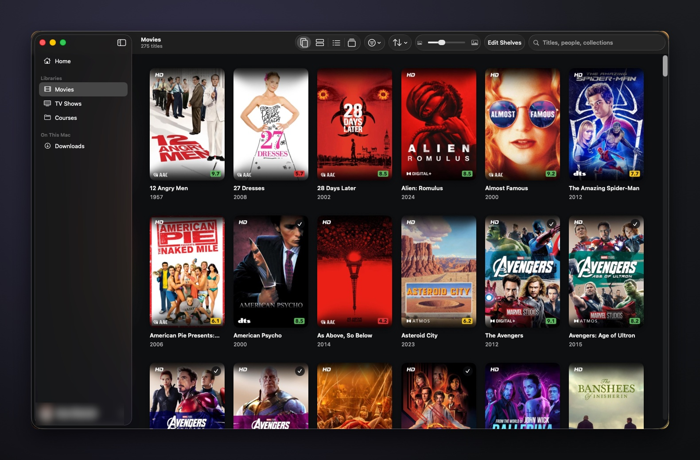

<p align="center">
  
</p>

<h1 align="center">Mezzanine</h1>

<p align="center">
  A native macOS client for Plex, made for watching.<br>
  Direct play, a binge flow that stays out of the way, and a keyboard for everything.
</p>

<p align="center">
  <a href="https://github.com/ahamedzoha/mezzanine/releases/latest"></a>
  <a href="https://github.com/ahamedzoha/mezzanine/actions/workflows/ci.yml"></a>
  
  
  
  <a href="LICENSE"></a>
</p>

<p align="center">
  
</p>

## Why Mezzanine

Plex's own Mac app transcodes too eagerly and mixes 5.1 down too quietly; Infuse plays
everything but flattens Plex's structure. Mezzanine keeps Plex's libraries, collections, Home
shelves and profiles, and plays the original file on the Mac itself through
[AetherEngine](https://github.com/superuser404notfound/AetherEngine), so the server never
transcodes unless a file truly can't play.

It's a SwiftUI app for macOS 26, designed around one idea: the room goes dark, the film is the
light. Everything works from the keyboard, every action has a menu item and a key you can change.

## Features

**Watching**
- Direct play of the original file (HEVC, AV1, HDR10, Dolby Vision, multichannel audio), with an
  automatic fallback to Plex remux, then transcode, only when a file won't open.
- Skip Intro and Skip Credits from Plex's markers, with per-show auto-skip rules; Up Next
  autoplay with the next episode warmed up in advance; "Still watching?"; post-play suggestions.
- Scrub previews, chapters, speed, snapshots, Picture in Picture, a mini player in the corner of
  the window, and picture size (Fit, Fill, Zoom) remembered per film or show.
- AirPlay and Google Cast (no SDK needed on the Mac): play on a TV, control it from the Mac.

**Sound**
- Audio profiles per output: speakers, headphones, AirPods and an HDMI receiver each get their own
  channel limit, LFE fold-down for 2.1, dialogue lift, night mode and loudness target. Receivers
  and AirPods get the original sound untouched.

**Subtitles**
- Styling, timing offset, sidecar files, Plex's own search, and Find Subtitles from several free
  sources at once.
- Generate subtitles from the dialogue on the Mac (Apple's on-device speech recognition), translate
  them on the Mac, and match any subtitle's timing to the speech.

**Library**
- A local index of the whole server, so browsing, search and sorting are instant.
- Home shelves you arrange: Plex rows, collections, playlists and smart shelves with a rule
  builder; a different Home per library.
- Quick Open (⌘K), a search panel that never leaves the page, folder browsing for personal media,
  an artwork picker, and an option to show posters without the badges servers add.
- Plex Home profiles with PINs and avatars; new-episode notifications.

**On the go**
- Downloads for offline viewing, with "keep the next N episodes downloaded" per show; progress
  syncs back when you're online.

**Updates**
- Mezzanine updates itself (Sparkle, EdDSA-signed): new versions download in the background and
  install when you quit, never in the middle of a film.

## Screenshots

| | |
|---|---|
|  |  |
|  |  |
|  |  |

## Install

1. Download `Mezzanine-x.y.z.dmg` from the
   [latest release](https://github.com/ahamedzoha/mezzanine/releases/latest).
2. Open it and drag **Mezzanine** into **Applications**.
3. Mezzanine is signed but not notarized, so macOS refuses to open it the first time. Open
   **System Settings ▸ Privacy & Security**, scroll to Security and click **Open Anyway** next to
   the note about Mezzanine. You only do this once; updates install without it.

**Requires** macOS 26 on Apple silicon and a Plex Media Server you can sign in to. Intro and
credits markers need Plex Pass on the server.

## Privacy

Mezzanine has no analytics and no account of its own. It talks to plex.tv (sign-in and server
discovery), your Plex servers, the subtitle sites you turn on, and GitHub (update checks). Your
Plex token stays in the Keychain. Speech recognition and translation run on the Mac. Playback is
reported to your server the way every Plex app does, so resume points and watch history stay in
sync.

## Build from source

You need Xcode 27.2 on macOS 26 (Apple silicon).

```bash
git clone https://github.com/ahamedzoha/mezzanine.git
cd mezzanine
cd MezzanineKit && swift test && cd ..        # core unit tests
xcodebuild -project Mezzanine.xcodeproj -scheme Mezzanine -destination 'platform=macOS' \
  -derivedDataPath build.noindex/DerivedData build
```

To run your own build, change the signing team in the Mezzanine target. Debug builds use a separate
bundle id (`com.mezzanine.mac.debug`), so they never touch an installed copy's settings or sign-in.
Read [`CONTRIBUTING.md`](CONTRIBUTING.md) before testing against a real server: development runs
must not write watch history.

| Path | What |
|---|---|
| `Mezzanine/` | The app (SwiftUI, main-actor by default) |
| `MezzanineKit/` | Swift package: the Plex client, local index (GRDB), subtitles, on-device speech, Google Cast, and `MezzaninePlayback`, the only code that touches the playback engine |
| `docs/ARCHITECTURE.md` | How it fits together |
| `DESIGN.md` | The design system ("Bias Light") and every screen's rules |
| `docs/ROADMAP.md` | What's next: watchlist, requests (Seerr), upcoming episodes (Sonarr/Radarr), server subtitles (Bazarr), stats (Tautulli), all optional; Plex alone stays a complete app |

## Contributing

Issues and pull requests are welcome; see [`CONTRIBUTING.md`](CONTRIBUTING.md). Security reports:
[`SECURITY.md`](SECURITY.md).

## Acknowledgements

[AetherEngine](https://github.com/superuser404notfound/AetherEngine) (playback, FFmpeg),
[GRDB](https://github.com/groue/GRDB.swift) (the local index),
[Sparkle](https://sparkle-project.org) (updates). Licenses of bundled components:
[`THIRD-PARTY-NOTICES.md`](THIRD-PARTY-NOTICES.md).

Mezzanine is an independent project, not affiliated with or endorsed by Plex, Inc. Plex is a
trademark of Plex, Inc.

## License

[MIT](LICENSE) © 2026 ahamedzoha
