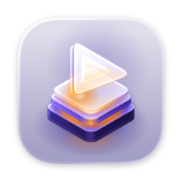
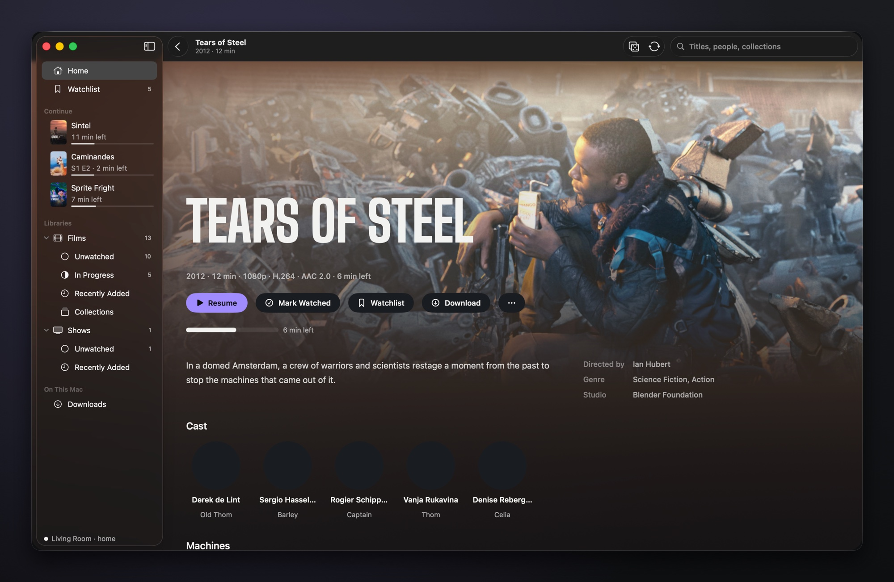
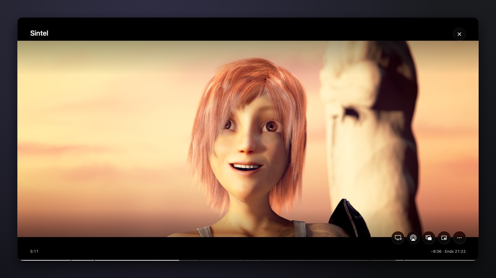
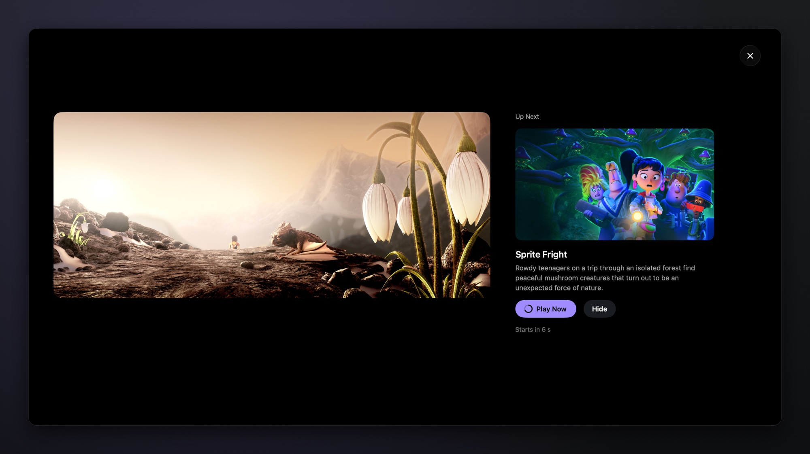
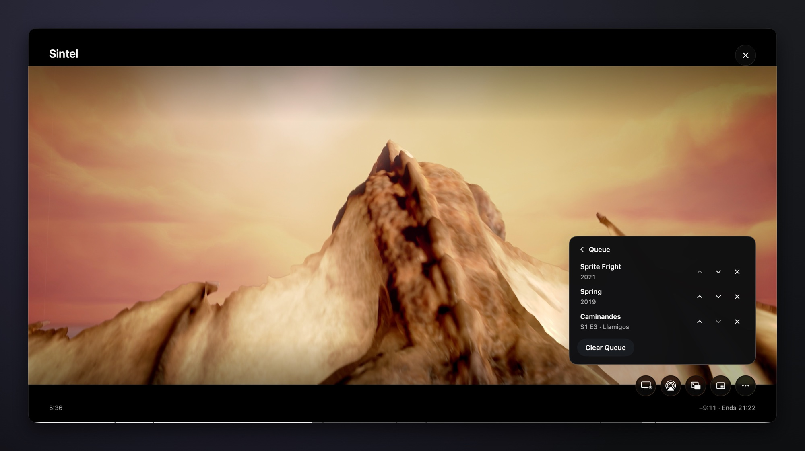
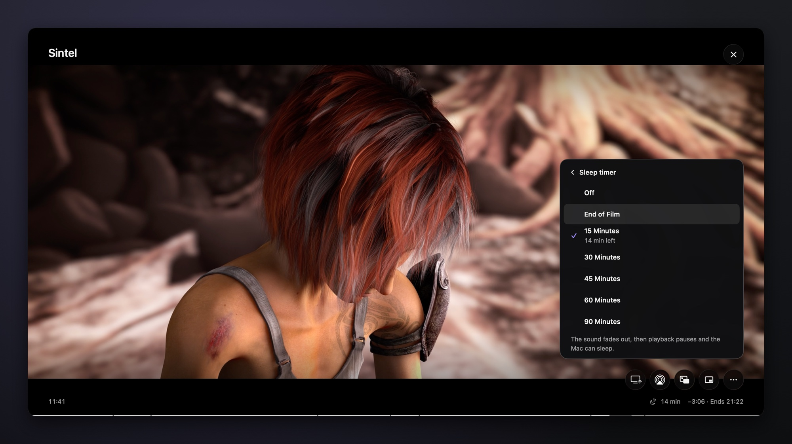
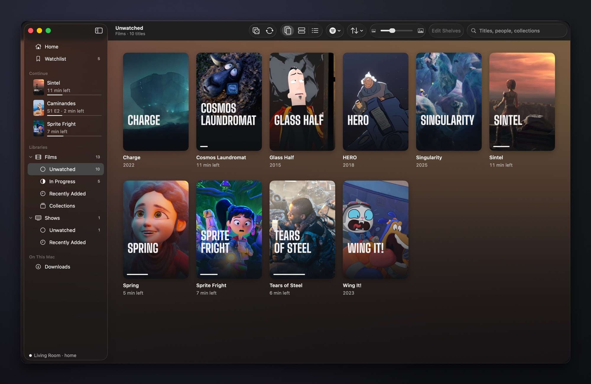
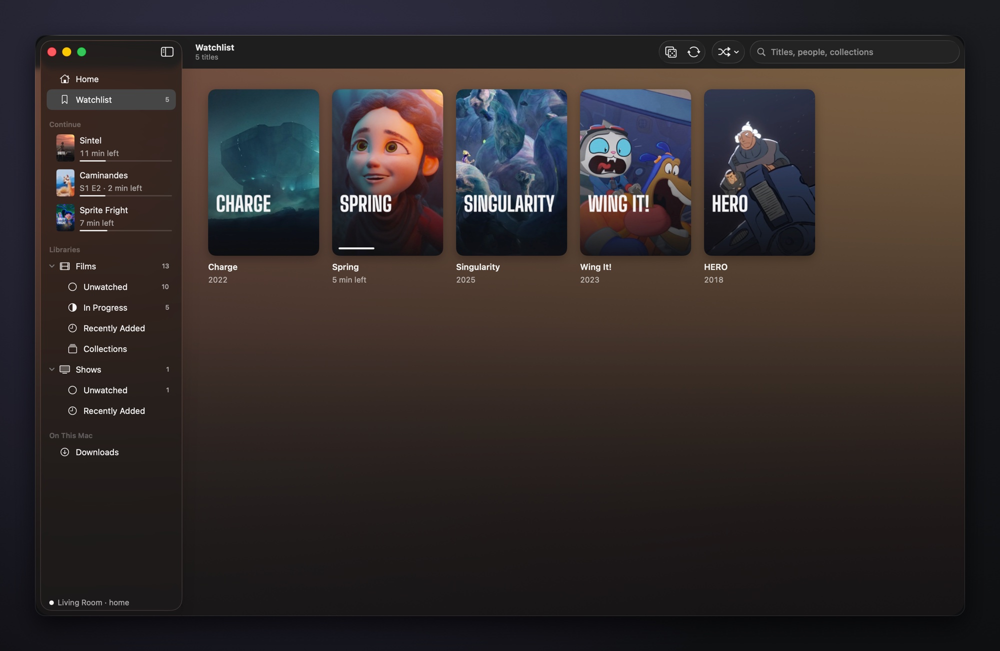
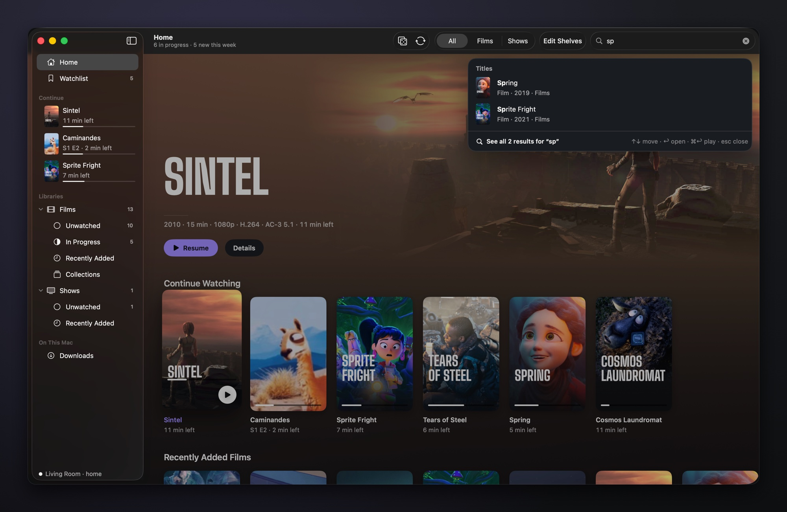

<p align="center">
  
</p>

<h1 align="center">Mezzanine</h1>

<p align="center">
  A native macOS client for Plex, made for watching.<br>
  Direct play, a binge flow that stays out of the way, and a keyboard for everything.
</p>

<p align="center"><a href="https://ahamedzoha.github.io/mezzanine/"><b>ahamedzoha.github.io/mezzanine</b></a></p>

<p align="center">
  <a href="https://github.com/ahamedzoha/mezzanine/releases/latest"></a>
  <a href="https://github.com/ahamedzoha/mezzanine/actions/workflows/ci.yml"></a>
  
  
  
  <a href="LICENSE"></a>
</p>

<p align="center">
  
</p>

## Why Mezzanine

Plex's own Mac app transcodes too eagerly and mixes 5.1 down too quietly; Infuse plays
everything but flattens Plex's structure. Mezzanine keeps Plex's libraries, collections, Home
shelves and profiles, and plays the original file on the Mac itself through
[AetherEngine](https://github.com/superuser404notfound/AetherEngine), so the server never
transcodes unless a file truly can't play.

It's a SwiftUI app for macOS 26, designed around one idea: the room goes dark, the film is the
light. Everything works from the keyboard, every action has a menu item and a key you can change.

## Features

### Playback
- **Direct play** of the original file: H.264, HEVC, AV1 and the older formats; HDR10 and Dolby
  Vision; stereo to Atmos. If a file won't open, Plex remuxes it, and only then converts it. You can
  also cap the quality yourself.
- **The binge flow.** Skip Intro and Skip Credits from Plex's markers, by key, button or automatic
  rule per show; Up Next with a countdown and the next episode already warmed up; "Still watching?";
  suggestions after a film.
- **Queue and Shuffle.** Play Next and Add to Queue on anything; Shuffle or Shuffle Unwatched for a
  show, season, collection, playlist or page. The queue plays before the next episode.
- **What did they say?** One key goes back ten seconds with subtitles, then turns them off again.
- **Sleep timer** for 15 to 90 minutes or the end of the episode or film. The sound fades out first.
- **Ends at** by the clock, **Go to Time**, chapters, scrub previews, frame steps, speed from 0.5× to
  2×, full-size snapshots.
- **Picture** Fit, Fill or Zoom, remembered per film or show; Picture in Picture; a mini player in
  the corner while you browse; full screen with nothing but the film.
- **AirPlay and Google Cast**: play on a TV and control it from the Mac.
- Media keys, Control Centre and AirPods work; the Mac stays awake while a film plays.

### Sound
- **A profile per output**, switched as you plug things in: Mac speakers, headphones, AirPods, 2.1
  speakers, an HDMI receiver. Channel limit, bass fold-down, dialogue lift, night mode and a loudness
  target; receivers and AirPods get the original sound untouched.
- **Volume to 400 %** into a limiter, so a quiet film can be loud without clipping.
- Audio delay, per-title tracks remembered on the server.

### Subtitles
- Text and picture subtitles (SRT, ASS, PGS, VobSub) at the right size and place; size, background
  and timing in the player; sidecar files.
- **Find Subtitles** searches Plex and several free sources at once.
- **Made on the Mac:** generate subtitles from the dialogue, translate them, and match any
  subtitle's timing to the speech. Nothing leaves the Mac.

### Library
- **A local index** of the whole server: browsing, sorting, filters and search answer at once.
- **A sidebar that knows what you're watching:** Continue rows with progress, each library's
  Unwatched, In Progress, Recently Added and Collections with counts, your pins, downloads and the
  server.
- **Home, arranged by you:** Plex rows, collections, playlists, your watchlist and smart shelves with
  a rule builder; a different Home per library; All, Films or Shows with one click.
- **Your Plex watchlist**, including titles that aren't on your server.
- Posters, wide, list, folders and shelves, with density and sort remembered per library; collection
  pages; a page for every film, show and season with cast, extras and related titles.
- **Quick Open** (⌘K), a search panel that never leaves the page, recent searches, and **Surprise Me**.
- Mark watched or unwatched, take titles out of Continue Watching, and play from the start, from any
  card's menu or the Item menu.
- Artwork picker, and an option to show posters without the badges servers add.
- **Spotlight** finds your films and shows; **Shortcuts and Siri** can resume, open or surprise you.

### Profiles, downloads, upkeep
- Plex Home profiles with PINs and avatars, each with its own shelves, pins, queue and progress;
  more than one server; new-episode notifications.
- **Downloads** for offline viewing with subtitles and artwork, "keep the next N episodes" per show;
  progress syncs back when you're online.
- **Remote control** from Plex Web (off by default).
- **A diagnostics report** you can save: crashes, hangs and the playback log without names, titles,
  addresses or tokens. Nothing is sent.
- **Updates itself** (Sparkle, EdDSA-signed), in the background and never in the middle of a film.

### Keyboard
Every player key can be changed in Settings ▸ Shortcuts, and every action is in a menu. ⌘/ shows them
all; some to start with:

| In the player | | Anywhere | |
|---|---|---|---|
| Space, K | Play, pause | ⌘K | Quick Open |
| ← → | 10 seconds | ⌘F | Search |
| S | Skip intro or credits | ⌘↩ | Play the focused title |
| N, ⇧N | Next, previous episode | W, ⇧W | Watched, watchlist |
| W | What did they say? | ⇧⌘R | Surprise Me |
| T | Go to a time | ⌥⌘A | Activity |
| Q | Queue | ⌃⌘W | Watchlist |
| ⌥S | Sleep timer | ⌘E | Edit shelves |
| ⌥M | Mini player | ⌘/ | All shortcuts |

VoiceOver, Full Keyboard Access, Reduce Motion, Increase Contrast and Text Size are supported.

## Screenshots

| | |
|---|---|
| <br>A show | <br>A film |
| <br>The player | <br>Options |
| <br>Up Next | <br>The queue |
| <br>Sleep timer | <br>Unwatched films |
| <br>Watchlist | <br>Search |

Pictures: open films by Blender ([credits](docs/screenshots/CREDITS.md)).

## Install

1. Download `Mezzanine-x.y.z.dmg` from the
   [latest release](https://github.com/ahamedzoha/mezzanine/releases/latest).
2. Open it and drag **Mezzanine** into **Applications**.
3. Mezzanine is signed but not notarized, so macOS refuses to open it the first time. Open
   **System Settings ▸ Privacy & Security**, scroll to Security and click **Open Anyway** next to
   the note about Mezzanine. You only do this once; updates install without it.

**Requires** macOS 26 on Apple silicon and a Plex Media Server you can sign in to. Intro and
credits markers need Plex Pass on the server.

## Privacy

Mezzanine has no analytics and no account of its own. It talks to plex.tv (sign-in, server
discovery and your watchlist), your Plex servers, the subtitle sites you turn on, and GitHub (update
checks). Your Plex token stays in the Keychain. Speech recognition, translation and the Spotlight
index stay on the Mac, and diagnostics reports are only ever saved to a file you choose. Playback is
reported to your server the way every Plex app does, so resume points and watch history stay in
sync.

## Build from source

You need Xcode 27.2 on macOS 26 (Apple silicon).

```bash
git clone https://github.com/ahamedzoha/mezzanine.git
cd mezzanine
cd MezzanineKit && swift test && cd ..        # core unit tests
xcodebuild -project Mezzanine.xcodeproj -scheme Mezzanine -destination 'platform=macOS' \
  -derivedDataPath build.noindex/DerivedData build
```

To run your own build, change the signing team in the Mezzanine target. Debug builds use a separate
bundle id (`com.mezzanine.mac.debug`), so they never touch an installed copy's settings or sign-in.
Read [`CONTRIBUTING.md`](CONTRIBUTING.md) before testing against a real server: development runs
must not write watch history.

| Path | What |
|---|---|
| `Mezzanine/` | The app (SwiftUI, main-actor by default) |
| `MezzanineKit/` | Swift package: the Plex client, local index (GRDB), subtitles, on-device speech, Google Cast, and `MezzaninePlayback`, the only code that touches the playback engine |
| `site/` | The website (GitHub Pages; built by `Scripts/site.py`) |
| `docs/ARCHITECTURE.md` | How it fits together |
| `DESIGN.md` | The design system ("Bias Light") and every screen's rules |
| `docs/ROADMAP.md` | What's next: requests (Seerr), upcoming episodes (Sonarr/Radarr), server subtitles (Bazarr), stats (Tautulli), all optional; Plex alone stays a complete app |

## Contributing

Issues and pull requests are welcome; see [`CONTRIBUTING.md`](CONTRIBUTING.md). Security reports:
[`SECURITY.md`](SECURITY.md).

## Acknowledgements

[AetherEngine](https://github.com/superuser404notfound/AetherEngine) (playback, FFmpeg),
[GRDB](https://github.com/groue/GRDB.swift) (the local index),
[Sparkle](https://sparkle-project.org) (updates). Licenses of bundled components:
[`THIRD-PARTY-NOTICES.md`](THIRD-PARTY-NOTICES.md).

Mezzanine is an independent project, not affiliated with or endorsed by Plex, Inc. Plex is a
trademark of Plex, Inc.

## License

[MIT](LICENSE) © 2026 ahamedzoha
